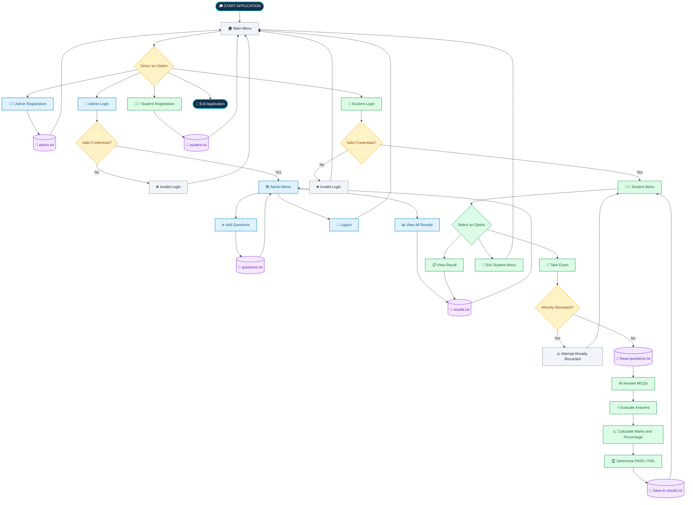

# 🎓 Smart Exam Management System | C++


---


## 📖 Project Overview

The **Smart Exam Management System** is a console-based application developed using **C++ and Object-Oriented Programming (OOP)** to conduct multiple-choice examinations and manage student results.

The application provides two separate modules: **Admin** and **Student**.

- **Admin:** Registers and logs in, adds examination questions, and views the results of students.
- **Student:** Registers and logs in, attends the examination, receives an automatically calculated score, and views the result.

The system stores administrator credentials, student details, questions, and examination results in text files using C++ file handling. This allows the stored data to remain available when the application is restarted.

### 💡 What Does This Project Do?

Instead of evaluating every answer manually, the application automates the examination process:

**Register → Login → Take Exam → Evaluate Answers → Calculate Percentage → Display Result**

## 🎯 Project Objectives

- Develop a structured, menu-driven examination application.
- Provide separate functionalities for administrators and students.
- Enable administrators to add multiple-choice questions.
- Allow students to attend examinations through a console interface.
- Automatically evaluate answers and calculate marks.
- Determine the pass/fail status based on the percentage obtained.
- Store examination data persistently using text files.
- Apply OOP, functions, loops, conditional statements, and file handling in a practical project.

## ✨ Key Features

| Feature | Description |
|---|---|
| 🔐 User Authentication | Separate admin and student registration and login |
| 📝 Question Management | Add questions with four options and a correct answer |
| 📚 MCQ Examination | Display questions and accept student answers |
| ⚡ Automatic Evaluation | Award one mark for each correct answer |
| 📊 Percentage Calculation | Calculate the examination percentage automatically |
| 🏆 Pass/Fail Evaluation | Pass with a score of 40% or above |
| 👤 Individual Results | Allow students to view their recorded results |
| 👨‍💼 Result Dashboard | Allow admins to view recorded student results |
| 💾 Persistent Storage | Save data in text files |
| 🚫 Attempt Restriction | Prevent another exam attempt when a result is already recorded |
| 🎨 Colored Console Interface | Use terminal colors and formatted menus |

## 🏗️ System Workflow

The following flowchart explains how the Admin and Student modules work together.



### 🔄 Workflow Explanation

1. **Application starts:** The main menu displays registration and login options.
2. **Admin operations:** The admin logs in, adds questions, and views student results.
3. **Student operations:** The student registers and logs in using their credentials.
4. **Exam verification:** The system checks whether a result has already been recorded for that student ID.
5. **Examination:** If the student has not attempted the exam, questions are loaded from `questions.txt`.
6. **Evaluation:** The system compares the submitted answers with the stored correct answers.
7. **Result generation:** Marks and percentages are calculated, and the PASS/FAIL status is determined.
8. **Data storage:** The result is appended to `results.txt` and can subsequently be viewed by the student or admin.

## 👨‍💼 Admin Module

The Admin Module provides the operations needed to manage examination questions and view student performance.

### 1. Admin Registration
- Accepts an administrator username and password.
- Stores the credentials in `admin.txt`.

### 2. Admin Login
- Accepts the registered username and password.
- Searches the stored records for a matching combination.
- Displays a success or invalid-login message.

### 3. Add Questions
The administrator enters:

- Question statement
- Option A
- Option B
- Option C
- Option D
- Correct answer (A/B/C/D)

The question is saved in `questions.txt` for use during examinations.

### 4. View All Student Results
Displays the recorded student results in a formatted table containing:

- Student ID
- Student name
- Percentage
- PASS/FAIL status

### 5. Admin Menu Options

| Option | Operation |
|---|---|
| 1 | Add Question |
| 2 | View All Results |
| 3 | Logout |
| 4 | Exit |

## 👩‍🎓 Student Module

The Student Module allows students to register, authenticate, take examinations, and view their results.

### 1. Student Registration
The student provides an ID, name, and password. These details are appended to `student.txt`.

### 2. Student Login
The application verifies the entered student ID and password against the stored student records.

It also checks whether the ID input is numeric before proceeding with authentication.

### 3. Take Examination
After successful login, the student can select the examination option.

The system:
- Checks whether the student already has a recorded result.
- Loads the questions from `questions.txt`.
- Displays each question and its four options.
- Accepts the selected answer.
- Compares it with the stored correct answer.
- Calculates the final score.

### 4. View Result
The student can retrieve their recorded result using their logged-in student ID.

The displayed information includes the student's ID, name, marks, percentage, and status.

### 5. Student Menu Options

| Option | Operation |
|---|---|
| 1 | Take Exam |
| 2 | View Result |
| 3 | Logout |
| 4 | Exit |

## 📝 Examination and Evaluation

### 📚 Question Format

Each question is stored as six lines in `questions.txt`:

```text
Question statement
Option A
Option B
Option C
Option D
Correct answer
```

For example:

```text
Who developed C++?
Dennis Ritchie
Bjarne Stroustrup
James Gosling
Guido van Rossum
B
```

The application reads these records sequentially to display the questions and evaluate the student's answers.

### ⚡ Answer Evaluation

- Each correct answer earns one mark.
- Incorrect answers do not earn marks.
- The total marks are calculated after the examination.
- The final percentage determines the student's status.

### 📐 Percentage Formula

**Percentage = (Marks Obtained / Total Questions) × 100**

### 🏆 Pass/Fail Criteria

| Percentage | Status |
|---|---|
| 40% or above | PASS |
| Below 40% | FAIL |

For example, if a student answers 12 out of 16 questions correctly:

- Marks obtained: 12/16
- Percentage: 75%
- Status: PASS

## 💾 File Handling and Data Storage

The application uses text files for storing and retrieving information instead of using a database.

| File | Stored Information | Purpose |
|---|---|---|
| `admin.txt` | Admin username and password | Admin authentication |
| `student.txt` | Student ID, name, and password | Student registration and login |
| `questions.txt` | Question, four options, and correct answer | Examination data |
| `results.txt` | Student ID, name, marks, percentage, and status | Result storage and retrieval |

### 🔧 File Handling Functions

| Function / Mode | Purpose |
|---|---|
| `ifstream` | Read existing file data |
| `ofstream` | Write data to a file |
| `ios::app` | Append records without overwriting existing content |
| `close()` | Close the file after processing |


## 🛠️ Technologies Used

- **Programming Language:** C++
- **Programming Paradigm:** Object-Oriented Programming (OOP)
- **Compiler:** GCC (`g++`)
- **Interface:** Command-Line Interface (CLI)
- **Data Storage:** Text files
- **Development Environment:** Linux / Ubuntu / WSL

### 📚 C++ Header Files

| Header | Purpose |
|---|---|
| `iostream` | Standard input and output |
| `fstream` | File operations |
| `string` | String data handling |
| `iomanip` | Formatted output using `setw()` and `left` |
| `cstring` | Included in the student source file |

## 📂 Project Structure

```text
Smart-Exam_Management-System/
│
├── main.cpp
│   └── Main menu and application entry point
│
├── admin.h
│   └── Admin class declaration
│
├── admin.cpp
│   └── Admin registration, login, question addition,
│       and result viewing
│
├── student.h
│   └── Student class declaration
│
├── student.cpp
│   └── Student registration, login, examination,
│       evaluation, and result viewing
│
├── admin.txt
│   └── Administrator credentials
│
├── student.txt
│   └── Student registration records
│
├── questions.txt
│   └── MCQ questions, options, and answers
│
├── results.txt
│   └── Examination results
│
└── README.md
    └── Project documentation
```

The `.h` files contain class declarations, while the `.cpp` files contain the corresponding function definitions and application logic.

The `.txt` files hold the records used by the program. They are created or populated when the application writes data.

## ⚙️ Installation and Execution

### Step 1: Install GCC

On Ubuntu or WSL, install the compiler if it is not already installed.

```bash
sudo apt update
sudo apt install g++
```

### Step 2: Clone the Repository

Replace the placeholder with your actual GitHub repository URL.

```bash
git clone https://github.com/shabeena1703/Smart-Exam-Management-System.git
```

### Step 3: Navigate to the Project Folder

```bash
cd Smart-Exam-Management-System
```

### Step 4: Compile the Source Files

Compile the three source files together.

```bash
g++ main.cpp admin.cpp student.cpp -o exam
```

### Step 5: Run the Application

```bash
./exam
```

### Step 6: Use the Application

The main menu provides five options:

```text
------------------------------------------------
                ONLINE EXAMINATION
------------------------------------------------
1.Admin registration
2.Admin login
3.student registration
4.student login
5.Exit

Enter the choice
```

**Recommended sequence:**

1. Register an admin.
2. Log in as admin.
3. Add questions to the examination.
4. Register a student.
5. Log in as the student.
6. Take the examination.
7. View the result.
8. Log in as admin to view all recorded student results.


## 🖥️ Sample Output

The following examples are based on the application's demonstrated terminal output.

### 1. 🏠 Main Menu

```text
------------------------------------------------
                ONLINE EXAMINATION
------------------------------------------------
1.Admin registration
2.Admin login
3.student registration
4.student login
5.Exit

Enter the choice
```

### 2. 🔐 Admin Login

```text
---------------------ADMIN LOGIN----------------------
Enter Username: shabee
Enter Password: @1234
Login Successful!
```

### 3. ➕ Add Question

```text
Enter Question: what is C++
Enter option A: object oriented
Enter option B: procedure oriented
Enter option C: both
Enter option D: none
Enter correct answer(A/B/C/D): A

Question Added Successfully
```

### 4. 👩‍🎓 Student Login

```text
--------------STUDENT LOGIN-------------------
Enter id:
1
Enter the password:
1234

Login Successful!
```

### 5. 📝 Examination Screen

```text
------------------------------------------------
                   START EXAM
------------------------------------------------

Question 1
What is the extension of a C++ source file?
A. .cpp
B. .txt
C. .html
D. .exe

Enter your answer: A
```

### 6. 📊 Admin Result Dashboard

```text
-------------------------------------------------
              ALL STUDENTS RESULTS
-------------------------------------------------
ID        Name                Percentage  Status
-------------------------------------------------
1         shabeena            100%        PASS
```

---

## 📊 Results

The application demonstrates the complete examination workflow, from user registration and authentication to automatic evaluation and result retrieval.

The demonstrated execution includes:

- Successful admin and student registration.
- Successful and unsuccessful login attempts.
- Adding examination questions.
- Evaluating a 16-question examination.
- Displaying a 0% FAIL result and a 100% PASS result.
- Preventing a student with an existing result from retaking the examination.
- Displaying the student's result and the admin's result dashboard.

## ⚠️ Limitations

- Passwords are stored as plain text.
- Duplicate student IDs and admin usernames are not prevented.
- Student names are read as single words.
- Answer comparison is case-sensitive; the student must enter the correct uppercase option.
- The system does not include an examination timer or question randomization.
- The application uses text files rather than a database.

## 🚀 Future Enhancements

- [ ] ✏️ Implement question modification and deletion.
- [ ] 🔐 Add secure password hashing.
- [ ] 🆔 Prevent duplicate student IDs and admin usernames.
- [ ] 🔠 Accept uppercase and lowercase answers.
- [ ] ⏱️ Introduce a time limit for examinations.
- [ ] 🎲 Randomize question order.
- [ ] 📈 Generate detailed student performance reports.
- [ ] 🗄️ Integrate a database such as MySQL.
- [ ] 🖥️ Develop a graphical user interface (GUI).
- [ ] 🌐 Extend the application into a web-based examination platform.

## 🧠 Learning Outcomes

Through this project, I gained practical experience in:

- Applying Object-Oriented Programming concepts using classes and objects.
- Organizing C++ programs into header and source files.
- Implementing registration and login workflows.
- Reading and writing persistent data using file handling.
- Using loops, conditional statements, and switch cases.
- Processing multiple-choice questions and evaluating answers.
- Calculating marks, percentages, and pass/fail status.
- Formatting console output using the `iomanip` library.

## 👩‍💻 Author

**Shabeena**

B.Tech – Electronics and Communication Engineering

- 🔗 **LinkedIn:** (https://www.linkedin.com/in/shaik-shabeena-36a7b9332)
- 📧 **Gmail:** (mailto:skshabeena33@gmail.com)
---


